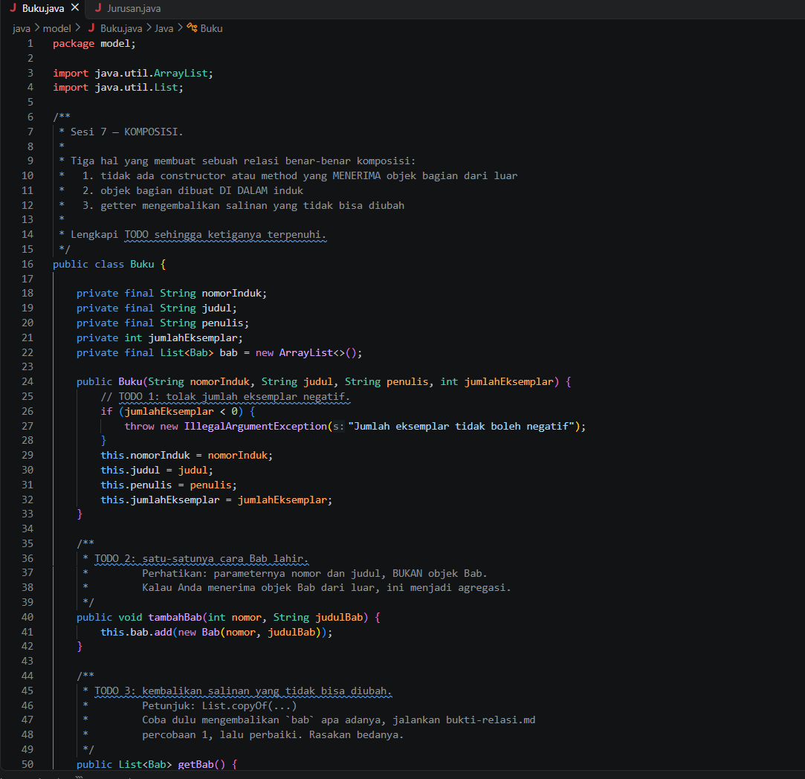
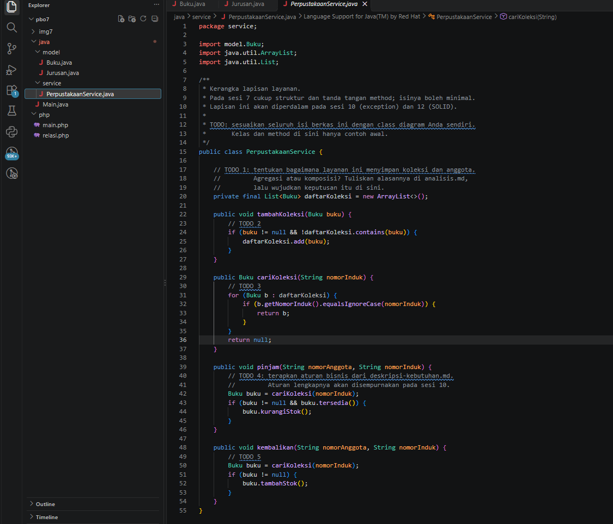
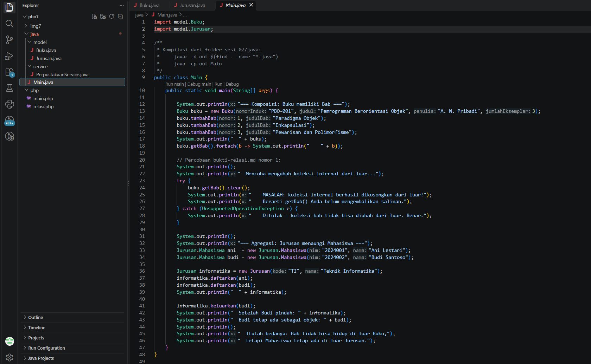
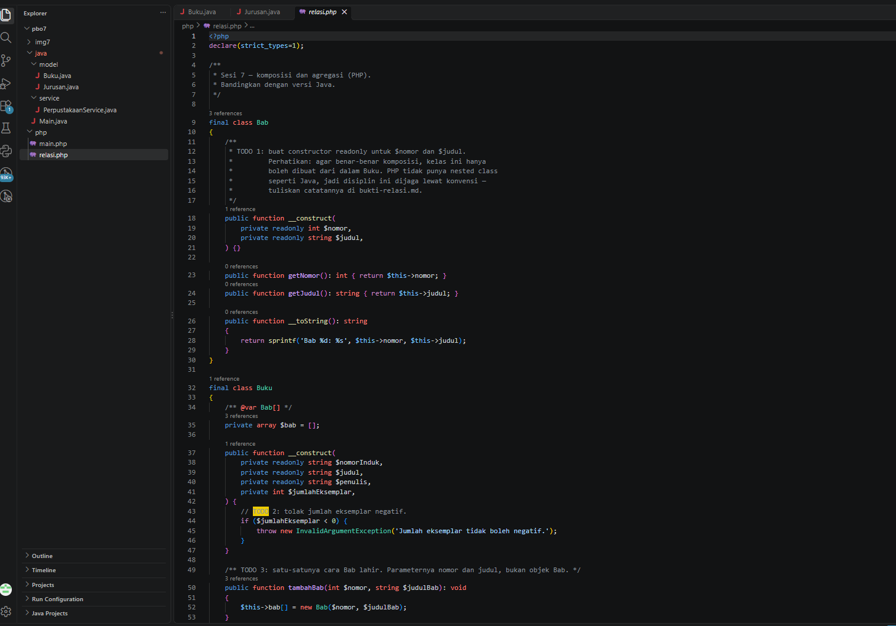
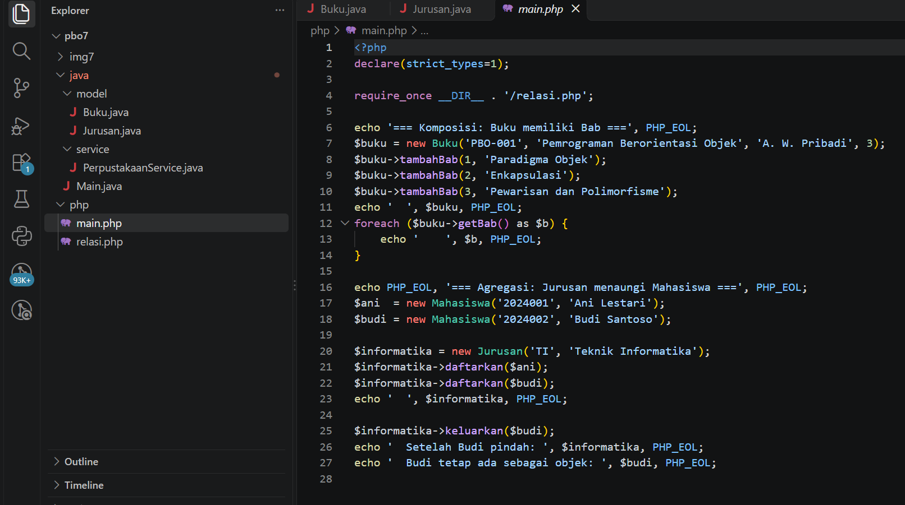

# Praktikum PBO - Pertemuan 7: Komposisi dan Agregasi

| Informasi Praktikan | Keterangan |
|---|---|
| Nama | Muzaki Arifin |
| NPM | 4525210051 |
| Kelas | A |
| Mata Kuliah | Pemrograman Berorientasi Objek (PBO) |
| Pertemuan | 7 - Komposisi dan Agregasi |
| Tanggal | 17 Oktober 2026 |

Repositori ini berisi implementasi relasi *has-a* berupa **Komposisi** dan **Agregasi** menggunakan Java dan PHP, lengkap dengan diagram UML dan dokumen analisisnya.

---

## 1. Implementasi Java

### 1.1. `Buku.java`

**Penjelasan Kode:**

Hubungan `Buku` dan `Bab` dibuat sebagai komposisi. `Bab` adalah nested class dengan constructor `private`, sehingga objeknya hanya bisa dibuat lewat `tambahBab(int, String)` milik `Buku`. Method `getBab()` mengembalikan `List.copyOf(...)`, yaitu salinan yang tidak dapat diubah, sehingga koleksi internal tetap aman dari modifikasi luar.

**Bukti Eksekusi (Screenshot):**



### 1.2. `Jurusan.java`

**Penjelasan Kode:**

`Jurusan` menerapkan agregasi terhadap `Mahasiswa`. Objek `Mahasiswa` dibuat di luar, lalu didaftarkan lewat `daftarkan(Mahasiswa m)`. Saat `keluarkan(Mahasiswa m)` dipanggil, hanya referensinya yang dilepas dari `Jurusan`, sedangkan objek `Mahasiswa` tetap hidup.

**Bukti Eksekusi (Screenshot):**


### 1.3. `PerpustakaanService.java`

**Penjelasan Kode:**

Kelas layanan yang mengelola koleksi buku dan transaksi perpustakaan. Relasinya dengan `Buku` adalah agregasi. Layanan yang tersedia: mencari buku berdasarkan nomor induk, meminjam (stok berkurang), dan mengembalikan (stok bertambah).

**Bukti Eksekusi (Screenshot):**



### 1.4. `Main.java`

**Penjelasan Kode:**

Entry point pengujian. Berisi penambahan `Bab` ke `Buku`, pembuktian bahwa `getBab()` tidak dapat dimodifikasi (pemanggilan `clear()` memicu `UnsupportedOperationException`), serta alur pendaftaran dan pengeluaran `Mahasiswa` pada `Jurusan`.

**Bukti Eksekusi (Screenshot):**



### Output Java


**Penjelasan Output:** Program menampilkan data buku beserta bab-babnya, menolak manipulasi koleksi bab dari luar, dan menampilkan proses pendaftaran serta pengeluaran mahasiswa tanpa menghapus objek mahasiswa itu sendiri.

**Cara menjalankan:**

```bash
javac *.java
java Main
```

---

## 2. Implementasi PHP

### 2.1. `relasi.php`

**Penjelasan Kode:**

Berisi struktur komposisi dan agregasi di PHP. `Bab` memakai properti `readonly`. `Buku` memegang `Bab` secara komposisi lewat `tambahBab()`. `Jurusan` menerapkan agregasi terhadap `Mahasiswa`, mencegah pendaftaran ganda, dan mengeluarkan objek menggunakan `array_filter`.

**Bukti Eksekusi (Screenshot):**



### 2.2. `main.php`

**Penjelasan Kode:**

Skrip utama yang mengimpor `relasi.php`. Menguji pembentukan komposisi `Buku` dan `Bab`, mendaftarkan mahasiswa ke `Jurusan` lewat perulangan, dan membuktikan bahwa objek `Mahasiswa` tetap ada setelah dikeluarkan dari `Jurusan`.

**Bukti Eksekusi (Screenshot):**



### Output PHP


**Penjelasan Output:** Program berjalan lancar, menampilkan struktur komposisi buku dan bab, serta membuktikan bahwa objek `Mahasiswa` berdiri sendiri di luar `Jurusan`.

**Cara menjalankan:**

```bash
php main.php
```

---

## 3. Diagram UML & Dokumentasi Analisis

### 3.1. `perpustakaan-class.puml`

**Penjelasan:**

Class diagram PlantUML dengan hierarki pewarisan `Koleksi` (`Buku`, `Majalah`, `Skripsi`), relasi komposisi (`Buku *-- Bab`), relasi agregasi (`Anggota o-- Peminjaman`, `PerpustakaanService o-- Koleksi`), serta enum `StatusKoleksi` dan `JenisKeanggotaan`.

<!-- Tambahkan gambar hasil render PlantUML di sini, mis.  -->

### 3.2. `bukti-relasi.md`

**Penjelasan:**

Dokumen pembuktian yang membandingkan proteksi imutabilitas koleksi pada Java (`List.copyOf`) dan PHP (array by-value dan properti `readonly`).

### 3.3. `analisis.md`

**Penjelasan:**

Dokumen analisis domain sistem perpustakaan: identifikasi kata benda dan kata kerja, penetapan invarian atau aturan bisnis, serta dasar pertimbangan memilih agregasi pada `PerpustakaanService`.

---

## 4. Kesimpulan

- **Komposisi** adalah kepemilikan kuat: bagian (`Bab`) tidak berdiri sendiri dan siklus hidupnya mengikuti induknya (`Buku`).
- **Agregasi** adalah kepemilikan longgar: bagian (`Mahasiswa`) dibuat di luar dan tetap hidup meski dilepas dari wadahnya (`Jurusan`).
- Proteksi koleksi dengan `List.copyOf(...)` di Java dan `readonly` di PHP penting untuk menjaga enkapsulasi.