**Nama:** Muzaki Arifin 
**NPM:** 4525210051 
**Kelas:** PBO A 2026/2027 
**Dosen Pengampu:** Adi Wahyu Pribadi, S.Si., M.Kom

Praktikum ini membangun Sistem Perpustakaan dengan struktur ala Maven (`src/main/java`), dibagi ke package `model`, `service`, dan `util`, serta memakai pustaka eksternal `ascii-table` (di folder `lib`) untuk menampilkan tabel di terminal.

## File Anggota.java

### Sebelum

[Lihat kode Anggota.java sebelum](ssan/ss-codingan-sebelum/java/pert-java-09-anggota.png).

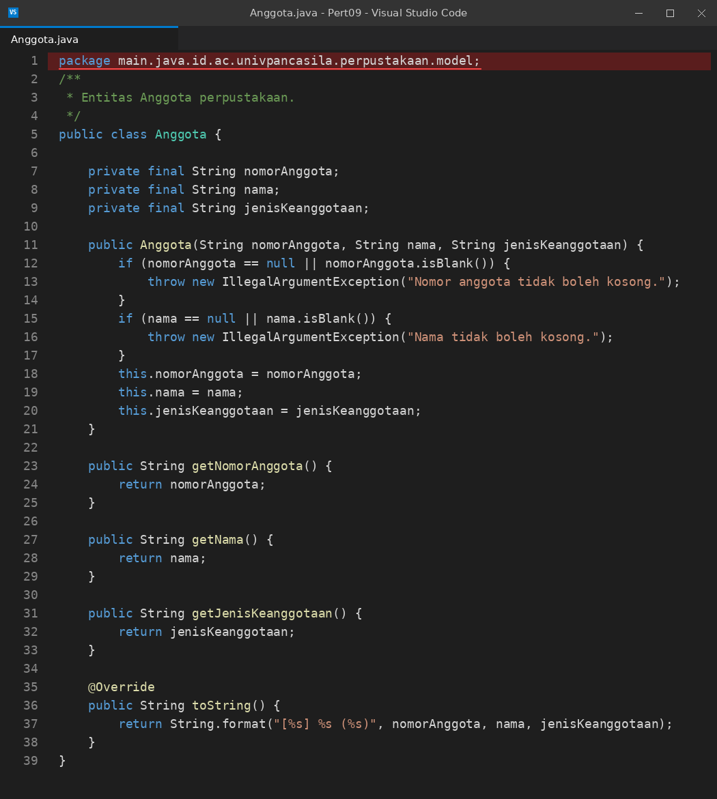

**Masalah:** baris pertama masih tertulis `package main.java.id.ac.univpancasila.perpustakaan.model;`. Pada struktur Maven, `src/main/java` adalah *source root*, jadi `main.java` tidak boleh ikut menjadi nama package. Akibatnya `App` dan `PerpustakaanService`, yang meng-import `id.ac.univpancasila.perpustakaan.model.Anggota`, tidak menemukan kelasnya.

### Setelah

[Lihat kode Anggota.java setelah](src/main/java/id/ac/univpancasila/perpustakaan/model/Anggota.java) ([screenshot](ssan/ss-codingan-sesudah/java/pert-java-09-anggota.png)).

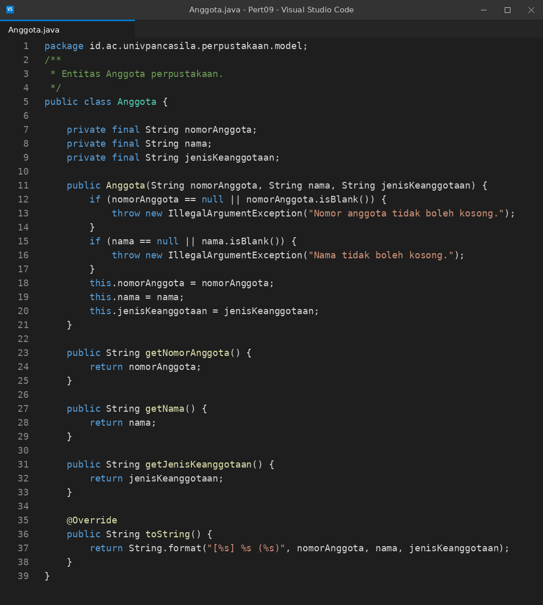

Package diganti menjadi `id.ac.univpancasila.perpustakaan.model`. Isi kelas tidak berubah: semua atribut `final` (immutable), dan konstruktor menolak nomor anggota atau nama yang kosong.

## File Buku.java

### Sebelum

[Lihat kode Buku.java sebelum](ssan/ss-codingan-sebelum/java/pert-java-09-buku.png).

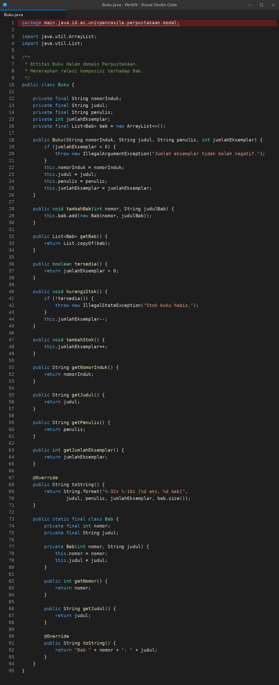

**Masalah:** sama seperti `Anggota.java`, deklarasi package masih memakai awalan `main.java`.

### Setelah

[Lihat kode Buku.java setelah](src/main/java/id/ac/univpancasila/perpustakaan/model/Buku.java) ([screenshot](ssan/ss-codingan-sesudah/java/pert-java-09-buku.png)).

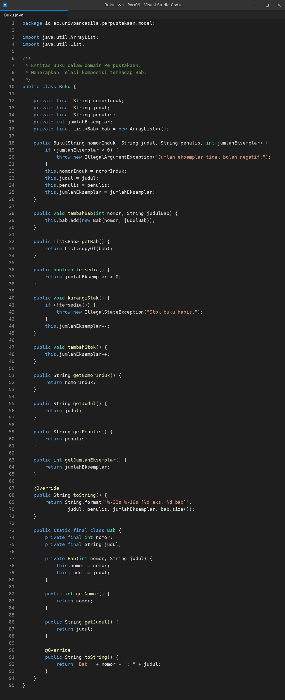

Package diperbaiki. `Buku` menerapkan relasi komposisi dengan `Bab` (nested class dengan konstruktor `private`, sehingga bab hanya bisa dibuat lewat `tambahBab`). Stok tidak boleh negatif, `kurangiStok()` melempar exception saat stok habis, dan `getBab()` mengembalikan salinan yang tidak bisa diubah.

## File Peminjaman.java

### Sebelum

[Lihat kode Peminjaman.java sebelum](ssan/ss-codingan-sebelum/java/pert-java-09-peminjaman.png).

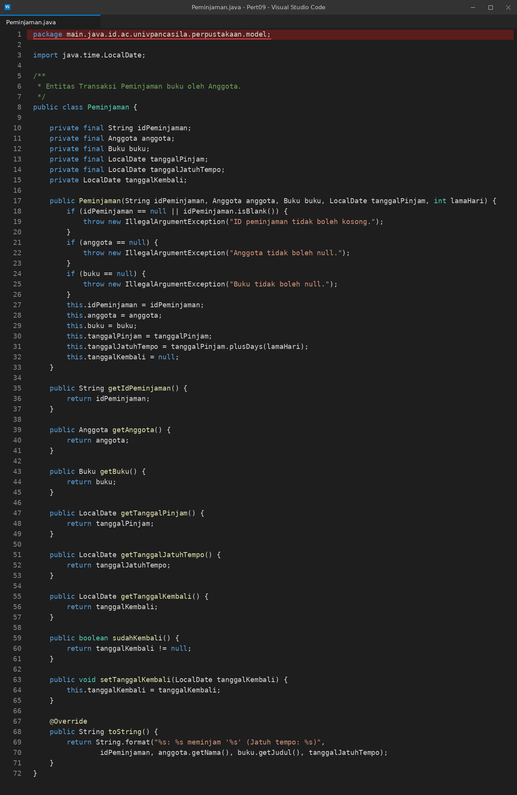

**Masalah:** deklarasi package yang sama, masih diawali `main.java`.

### Setelah

[Lihat kode Peminjaman.java setelah](src/main/java/id/ac/univpancasila/perpustakaan/model/Peminjaman.java) ([screenshot](ssan/ss-codingan-sesudah/java/pert-java-09-peminjaman.png)).

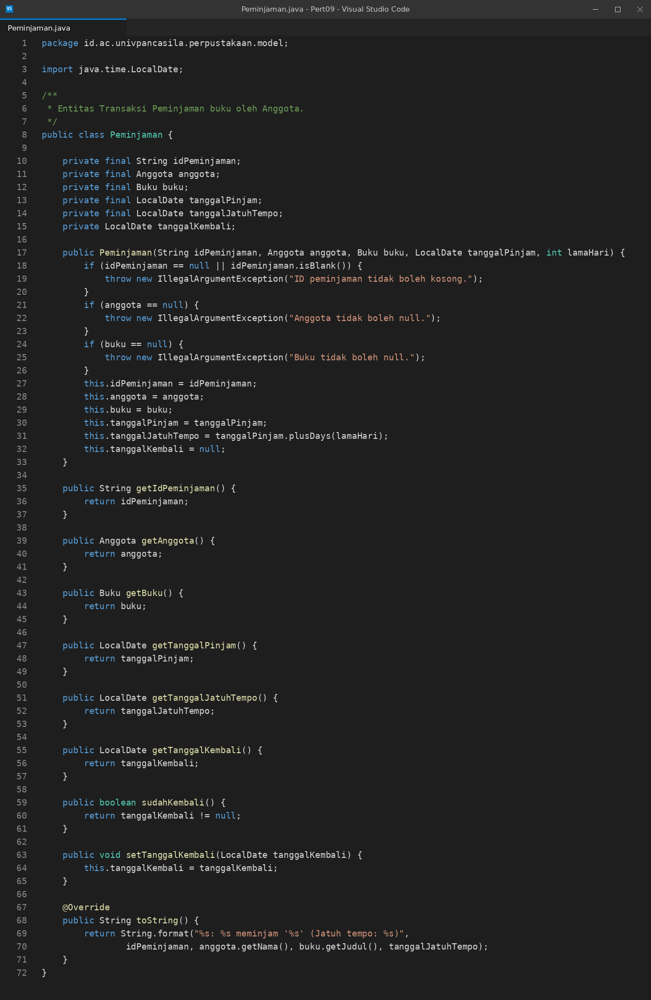

Package diperbaiki. Tanggal jatuh tempo dihitung otomatis dari `tanggalPinjam.plusDays(lamaHari)`, dan status pengembalian dicek lewat `sudahKembali()` (tanggal kembali tidak `null`).

## File PerpustakaanService.java

### Sebelum

[Lihat kode PerpustakaanService.java sebelum](ssan/ss-codingan-sebelum/java/pert-java-09-perpustakaanservice.png).

Kodenya sama persis dengan versi setelah. File ini hanya ikut gagal compile karena kelas di package `model` tidak ditemukan.

### Setelah

[Lihat kode PerpustakaanService.java](src/main/java/id/ac/univpancasila/perpustakaan/service/PerpustakaanService.java) ([screenshot](ssan/ss-codingan-sesudah/java/pert-java-09-perpustakaanservice.png)).

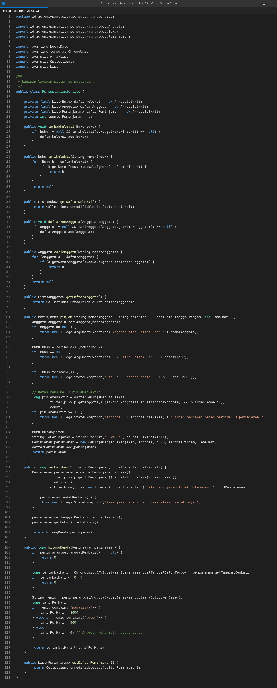

Lapisan layanan yang mengelola koleksi, anggota, peminjaman, dan pengembalian. Saat `pinjam()`, service menolak anggota atau buku yang tidak ditemukan, stok yang habis, dan anggota yang sudah memegang 3 pinjaman aktif. Denda keterlambatan dihitung di `hitungDenda()`: Rp1.000 per hari untuk mahasiswa dan Rp500 per hari untuk dosen.

## File Format.java

### Sebelum

[Lihat kode Format.java sebelum](ssan/ss-codingan-sebelum/java/pert-java-09-format.png).

Kodenya sama persis dengan versi setelah. File ini tidak bergantung pada package `model`, jadi tidak ikut error.

### Setelah

[Lihat kode Format.java](src/main/java/id/ac/univpancasila/perpustakaan/util/Format.java) ([screenshot](ssan/ss-codingan-sesudah/java/pert-java-09-format.png)).

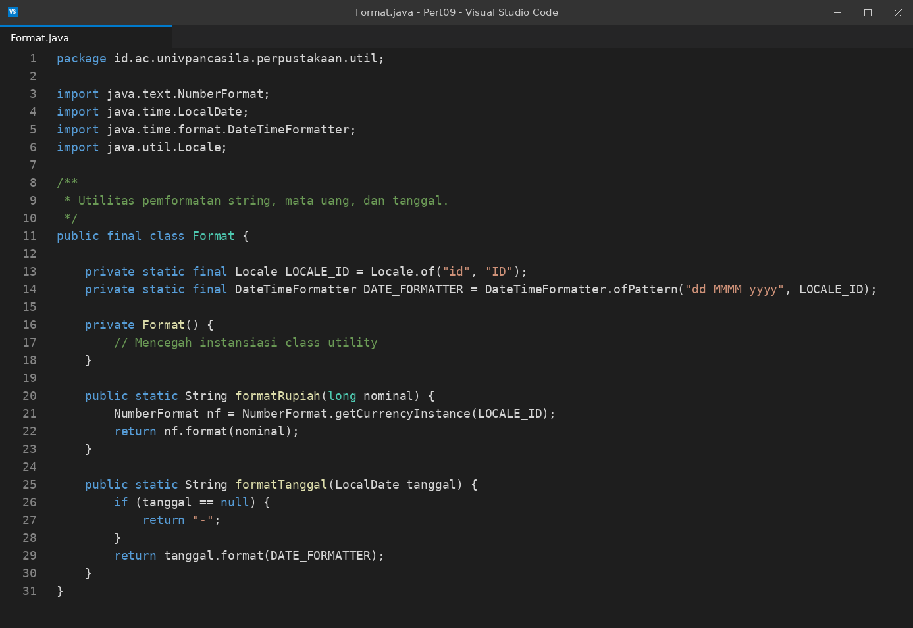

Kelas utilitas dengan konstruktor `private` dan locale Indonesia. `formatRupiah` memformat mata uang (contoh `Rp5.000,00`), sedangkan `formatTanggal` memformat tanggal ke `dd MMMM yyyy` dan mengembalikan `-` jika tanggalnya `null`.

## File App.java

### Sebelum

[Lihat kode App.java sebelum](ssan/ss-codingan-sebelum/java/pert-java-09-app.png).

Kodenya sama persis dengan versi setelah. `App` ikut gagal compile karena meng-import kelas dari package `model` yang belum ditemukan.

### Setelah

[Lihat kode App.java](src/main/java/id/ac/univpancasila/perpustakaan/App.java) ([screenshot](ssan/ss-codingan-sesudah/java/pert-java-09-app.png)).

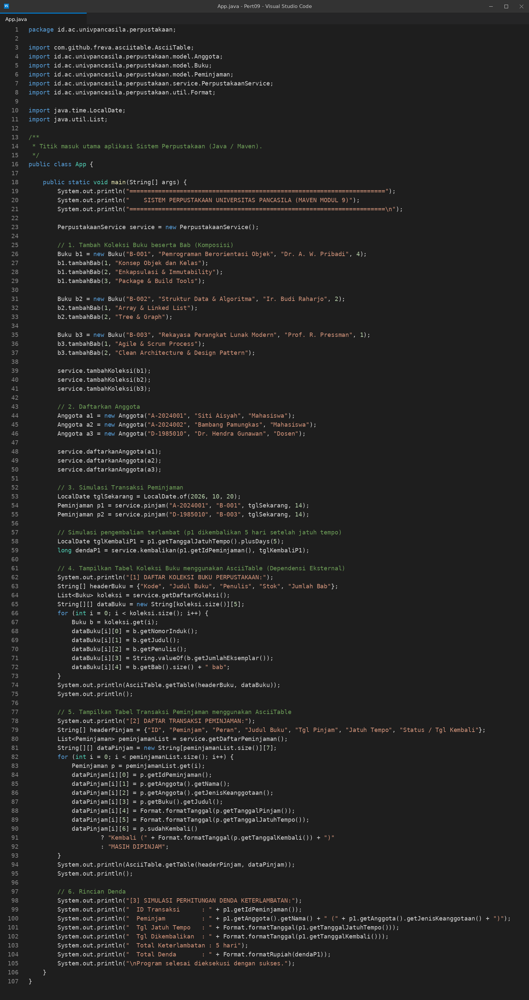

`App` menambahkan 3 buku beserta babnya, mendaftarkan 3 anggota, mensimulasikan 2 peminjaman pada 20 Oktober 2026, lalu mengembalikan peminjaman pertama 5 hari setelah jatuh tempo. Tabel koleksi dan tabel transaksi dicetak dengan `AsciiTable.getTable(...)`, diikuti rincian denda.

## Hasil keseluruhan

### Sebelum

Perintah compile gagal dengan 43 error, semuanya berasal dari package `model` yang tidak ditemukan.

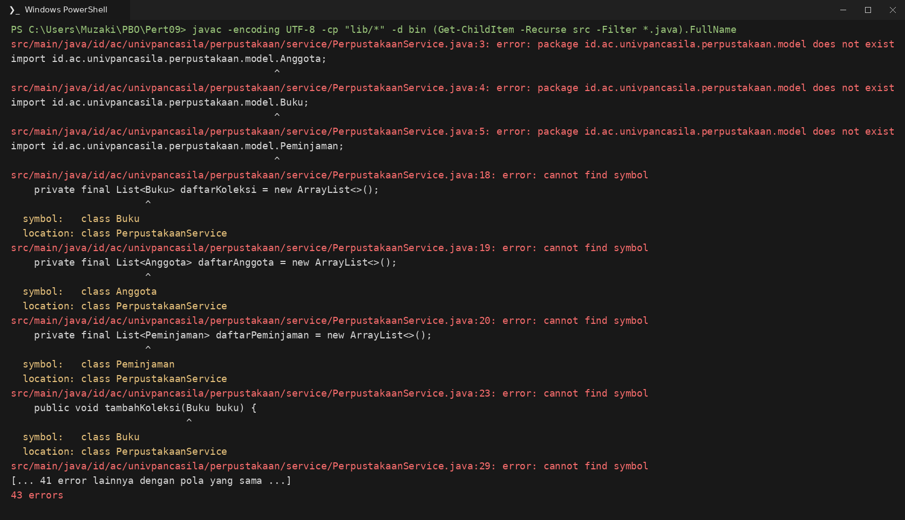

### Setelah

Setelah package pada tiga file model diperbaiki, compile berhasil dan program berjalan.

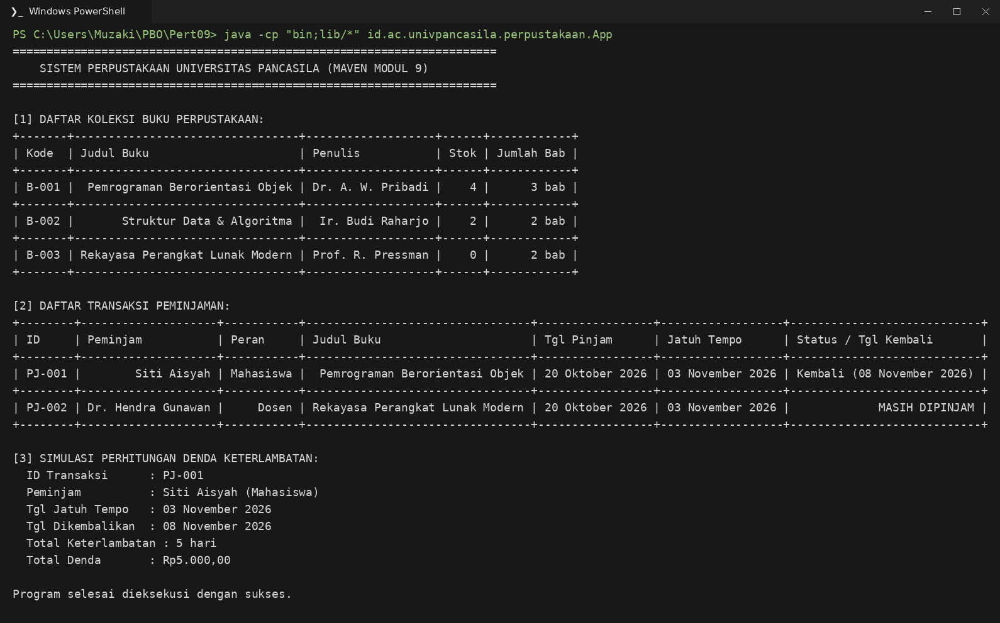

Penjelasan keluaran:

- **Tabel koleksi:** stok `B-001` tetap 4 karena bukunya sudah dikembalikan. Stok `B-003` menjadi 0 karena masih dipinjam Dr. Hendra Gunawan.
- **Tabel transaksi:** `PJ-001` sudah kembali pada 08 November 2026, sedangkan `PJ-002` berstatus `MASIH DIPINJAM`.
- **Denda:** jatuh tempo 03 November 2026 dan dikembalikan 08 November 2026, jadi terlambat 5 hari. Siti Aisyah (Mahasiswa) dikenai 5 × Rp1.000 = **Rp5.000,00**.