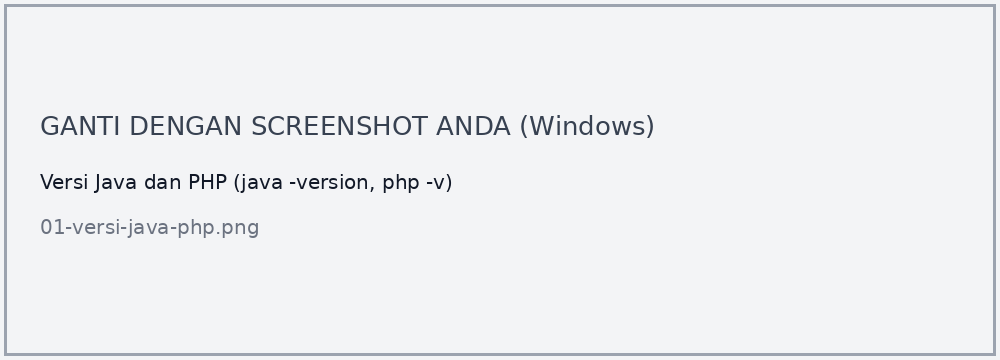
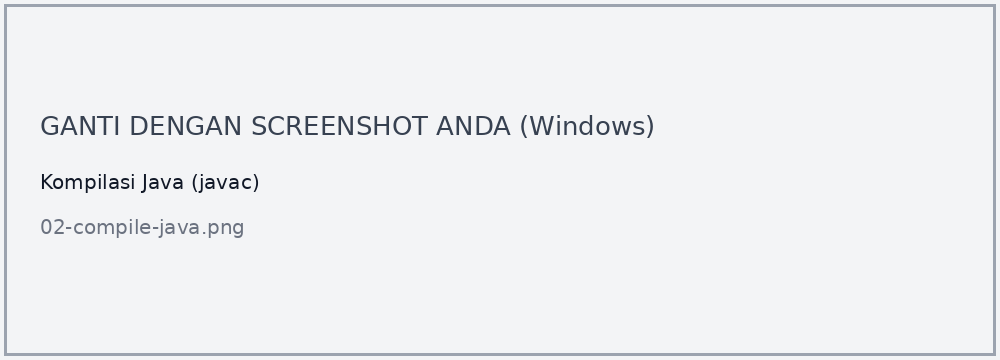
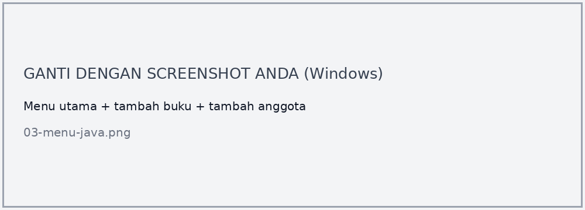
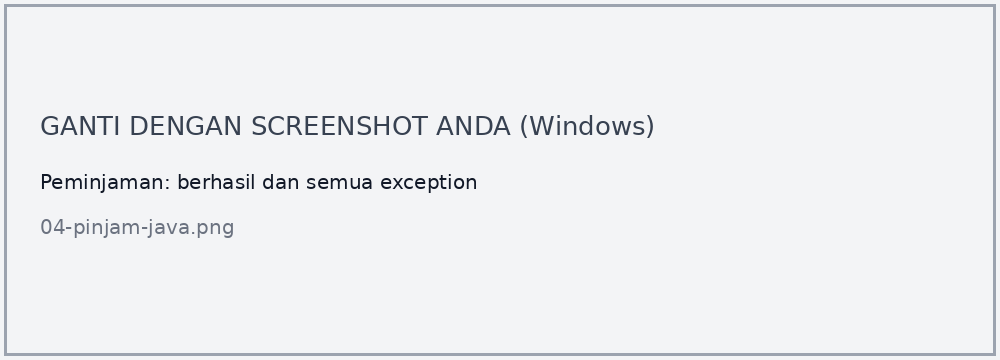
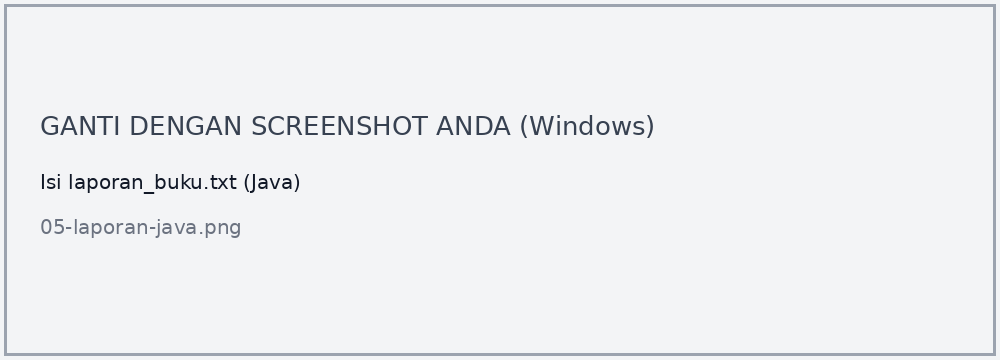
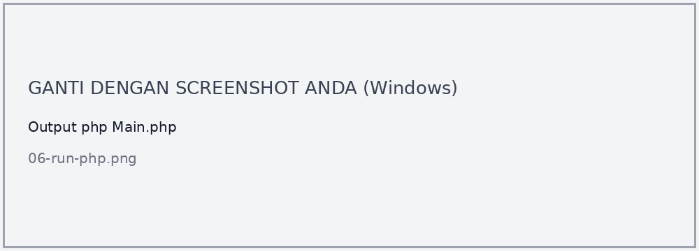
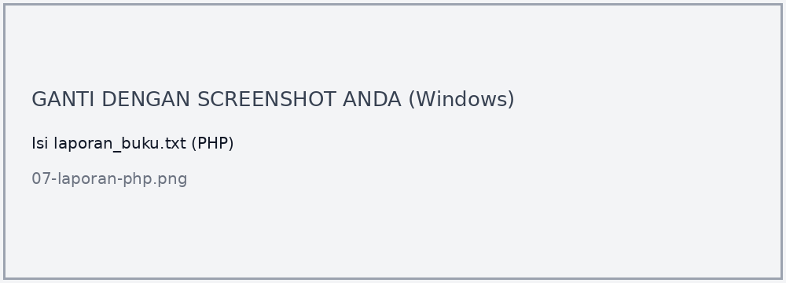

**Nama:** Muzaki Arifin<br>
**NPM:** 4525210051<br>
**Kelas:** PBO A 2026/2027<br>
**Dosen Pengampu:** Adi Wahyu Pribadi, S.Si., M.Kom

Praktikum Pertemuan 10 ini membahas *exception handling* dan pemrograman defensif pada Sistem Perpustakaan. Proyek dibuat dalam dua versi, **Java** (struktur Maven `src/main/java`) dan **PHP** (autoload Composer). Method `pinjam()` yang semula bersarang empat tingkat dan hanya mengembalikan `false` direfaktor menjadi *guard clause* yang melempar exception domain sesuai penyebab kegagalan.

## Struktur Proyek

```
Pert10/
├── README.md
├── skenario-uji.md
├── screenshots/
├── java/
│   ├── pom.xml
│   └── src/main/java/id/ac/univpancasila/perpustakaan/
│       ├── Main.java
│       ├── exception/      (PerpustakaanException + 4 turunan)
│       └── service/        (LibraryServiceKotor, LibraryService, PerpustakaanService)
└── php/
    ├── composer.json
    ├── Main.php
    └── src/
        ├── Exception/
        └── Service/        (LibraryServiceKotor, LibraryService)
```

## File LibraryService.java

### Sebelum

[Lihat kode LibraryServiceKotor.java](java/src/main/java/id/ac/univpancasila/perpustakaan/service/LibraryServiceKotor.java).

```java
public boolean pinjam(String idAnggota, String isbn) {
    if (pinjaman.containsKey(idAnggota)) {
        if (stok.containsKey(isbn)) {
            if (stok.get(isbn) > 0) {
                if (pinjaman.get(idAnggota) < BATAS_PINJAM) {
                    stok.merge(isbn, -1, Integer::sum);
                    pinjaman.merge(idAnggota, 1, Integer::sum);
                    return true;
                } else {
                    return false; // kenapa gagal? pemanggil tidak tahu
                }
            } else {
                return false; // kenapa gagal? pemanggil tidak tahu
            }
        } else {
            return false; // kenapa gagal? pemanggil tidak tahu
        }
    } else {
        return false; // kenapa gagal? pemanggil tidak tahu
    }
}
```

**Masalah:**
1. Logika utama (`stok.merge` dan `pinjaman.merge`) berada di dalam **4 tingkat** `if`, jauh menjorok ke kanan sehingga sulit ditemukan.
2. Jika satu syarat gagal, method hanya mengembalikan `false`. Pemanggil **tidak tahu alasannya**: anggota tidak ada, buku tidak ada, stok habis, atau batas pinjam tercapai, semuanya terlihat sama.
3. Menambah aturan baru berarti menambah satu tingkat `if` dan satu cabang `else` lagi, sehingga rawan salah kurung dan salah cabang.

### Setelah

[Lihat kode LibraryService.java](java/src/main/java/id/ac/univpancasila/perpustakaan/service/LibraryService.java).

```java
public boolean pinjam(String idAnggota, String isbn) {
    if (!pinjaman.containsKey(idAnggota)) {
        throw new AnggotaTidakDitemukanException(idAnggota);
    }
    if (!stok.containsKey(isbn)) {
        throw new BukuTidakDitemukanException(isbn);
    }
    if (stok.get(isbn) <= 0) {
        throw new BukuSedangDipinjamException(isbn, judul.get(isbn));
    }
    if (pinjaman.get(idAnggota) >= BATAS_PINJAM) {
        throw new BatasPinjamTerlampauiException(idAnggota, BATAS_PINJAM);
    }

    stok.merge(isbn, -1, Integer::sum);
    pinjaman.merge(idAnggota, 1, Integer::sum);
    return true;
}
```

Setiap syarat diperiksa di awal dan langsung melempar exception yang menyebut alasannya, sehingga logika utama berada di tingkat paling luar tanpa nesting. Urutan pemeriksaan: anggota, buku, stok, lalu batas pinjam. Aturan baru cukup ditambah satu blok `if (...) throw ...;` tanpa menyentuh alur lain.

## File Exception (Java)

### Sebelum

Belum ada. Kegagalan hanya ditandai dengan `return false` sehingga tidak ada informasi penyebab.

### Setelah

[Lihat folder exception](java/src/main/java/id/ac/univpancasila/perpustakaan/exception/).

| Class | Membawa data | Dilempar saat |
|-------|--------------|---------------|
| [`PerpustakaanException`](java/src/main/java/id/ac/univpancasila/perpustakaan/exception/PerpustakaanException.java) (abstract) | - | Induk semua exception domain |
| [`AnggotaTidakDitemukanException`](java/src/main/java/id/ac/univpancasila/perpustakaan/exception/AnggotaTidakDitemukanException.java) | `idAnggota` | Anggota belum terdaftar |
| [`BukuTidakDitemukanException`](java/src/main/java/id/ac/univpancasila/perpustakaan/exception/BukuTidakDitemukanException.java) | `isbn` | ISBN tidak ada di katalog |
| [`BukuSedangDipinjamException`](java/src/main/java/id/ac/univpancasila/perpustakaan/exception/BukuSedangDipinjamException.java) | `isbn`, `judul` | Stok eksemplar habis |
| [`BatasPinjamTerlampauiException`](java/src/main/java/id/ac/univpancasila/perpustakaan/exception/BatasPinjamTerlampauiException.java) | `idAnggota`, `batas` | Anggota sudah meminjam 3 buku |

`PerpustakaanException` diturunkan dari `RuntimeException` (**unchecked**). Kegagalan ini menandakan permintaan yang tidak sah, bukan keadaan luar yang bisa dipulihkan dengan mengulang pemanggilan, jadi setiap method tidak dipaksa menulis `throws` atau `try-catch`. Dengan induk bersama, pemanggil dapat menangkap seluruh kegagalan domain lewat satu `catch (PerpustakaanException e)`. Setiap exception membawa data penyebabnya lewat atribut `final` dan getter, jadi pemanggil tidak perlu mengurai kalimat pesan. Uraian lengkap ada di [skenario-uji.md](skenario-uji.md).

## File PerpustakaanService.java

### Sebelum

Belum ada penanganan exception. Hasil `pinjam()` hanya `true` atau `false`, sehingga lapisan tampilan tidak bisa memberi pesan yang spesifik.

### Setelah

[Lihat kode PerpustakaanService.java](java/src/main/java/id/ac/univpancasila/perpustakaan/service/PerpustakaanService.java).

```java
try {
    libService.pinjam(idAngota, isbn);
    System.out.println("Peminjaman Berhasil!");
} catch (PerpustakaanException e) {
    System.out.println("[Error Domain] " + e.getMessage());

    if (e instanceof BukuTidakDitemukanException ex) {
        System.out.println("ISBN bermasalah: " + ex.getIsbn());
    } else if (e instanceof AnggotaTidakDitemukanException ex) {
        System.out.println("Id Anggota bermasalah: " + ex.getIdAnggota());
    } else if (e instanceof BukuSedangDipinjamException ex) {
        System.out.println(" -> Judul Buku: " + ex.getJudul() + " (ISBN: " + ex.getIsbn() + ")");
    } else if (e instanceof BatasPinjamTerlampauiException ex) {
        System.out.println(" -> Batas Maksimum: " + ex.getBatas() + " buku");
    }
} catch (Exception e) {
    System.out.println("[Error Sistem] Terjadi kesalahan input " + e.getMessage());
}
```

Exception domain ditangkap di satu lapisan, lalu data penyebabnya (`getIsbn()`, `getIdAnggota()`, `getJudul()`, `getBatas()`) dipakai untuk menyusun pesan. Selain itu, `tambahBuku` dan `tambahAnggota` memvalidasi input: ID atau ISBN kosong ditolak, dan jumlah eksemplar yang bukan angka atau kurang dari 1 ditolak lewat `NumberFormatException`. Pada form peminjaman, ketik `exit` untuk kembali ke menu.

## File Main.java

### Sebelum

Belum ada. Program belum punya menu dan belum mengekspor laporan.

### Setelah

[Lihat kode Main.java](java/src/main/java/id/ac/univpancasila/perpustakaan/Main.java).

`Main` menampilkan menu interaktif (Tambah Buku, Tambah Anggota, Pinjam Buku, Keluar). Saat keluar, `eksporLaporan()` menulis `laporan_buku.txt` memakai **try-with-resources** sehingga `PrintWriter` ditutup otomatis, dan `IOException` ditangani dengan pesan yang jelas.

## File LibraryService.php

### Sebelum

[Lihat kode LibraryServiceKotor.php](php/src/Service/LibraryServiceKotor.php). Strukturnya sama dengan versi Java: `pinjam()` bersarang empat tingkat, mengembalikan `bool`, dan tidak menjelaskan alasan kegagalan.

### Setelah

[Lihat kode LibraryService.php](php/src/Service/LibraryService.php) dan [folder Exception PHP](php/src/Exception/).

```php
public function pinjam(string $idAnggota, string $isbn): void
{
    if (!array_key_exists($idAnggota, $this->pinjaman)) {
        throw new AnggotaTidakDitemukanException($idAnggota);
    }
    if (!array_key_exists($isbn, $this->stok)) {
        throw new BukuTidakDitemukanException($isbn);
    }
    if ($this->stok[$isbn] <= 0) {
        throw new BukuSedangDipinjamException($isbn, $this->judul[$isbn]);
    }
    if ($this->pinjaman[$idAnggota] >= self::BATAS_PINJAM) {
        throw new BatasPinjamTerlampauiException($idAnggota, self::BATAS_PINJAM);
    }

    $this->stok[$isbn]--;
    $this->pinjaman[$idAnggota]++;
}
```

Logikanya sama dengan Java. Exception PHP memakai *constructor property promotion* (`private readonly`). PHP tidak mengenal checked exception, sehingga anotasi `@throws` pada PHPDoc dipakai sebagai pengganti peringatan kompilator.

## File Main.php

### Sebelum

Belum ada. Tidak ada skrip demo untuk menguji ketujuh skenario.

### Setelah

[Lihat kode Main.php](php/Main.php).

`Main.php` menjalankan 7 percobaan peminjaman dalam satu `foreach` dengan `try-catch (PerpustakaanException)`, lalu `createReport()` menulis `laporan_buku.txt`. Berkas dibuka dengan `fopen`, dan blok **`finally`** menjamin berkas selalu ditutup dengan `fclose` walaupun terjadi error di tengah penulisan.

## Skenario Uji

Data awal: buku `111` "Laskar Pelangi" (1 eksemplar), buku `222` "Bumi Manusia" (5 eksemplar), anggota `A-001` dan `A-002`, batas pinjam 3.

| No | Anggota | ISBN | Hasil |
|----|---------|------|-------|
| 1 | A-001 | 111 | Berhasil |
| 2 | A-002 | 111 | `BukuSedangDipinjamException` |
| 3 | A-002 | 999 | `BukuTidakDitemukanException` |
| 4 | X-999 | 222 | `AnggotaTidakDitemukanException` |
| 5 | A-001 | 222 | Berhasil |
| 6 | A-001 | 222 | Berhasil |
| 7 | A-001 | 222 | `BatasPinjamTerlampauiException` |

## Hasil keseluruhan

### Sebelum

Dengan `LibraryServiceKotor`, semua kegagalan hanya menghasilkan `false`, jadi kelima kegagalan di tabel skenario tidak bisa dibedakan.

### Setelah

**Versi Java**

Versi JDK dan PHP:



Kompilasi:

```powershell
cd java
mkdir out
javac -d out (Get-ChildItem -Recurse src -Filter *.java).FullName
```



Menjalankan program:

```powershell
java -cp out id.ac.univpancasila.perpustakaan.Main
```



Hasil uji peminjaman:

```
[Error Domain] Buku Laskar Pelangi dengan ISBN 111 sedang dipinjam
 -> Judul Buku: Laskar Pelangi (ISBN: 111)

[Error Domain] Buku dengan ISBN 999 tidak ditemukan
ISBN bermasalah: 999

[Error Domain] Anggota dengan ID X-999 tidak ditemukan
Id Anggota bermasalah: X-999

[Error Domain] Anggota dengan ID A-001 telah mencapai batas maksimum peminjaman
 -> Batas Maksimum: 3 buku
```



Laporan `laporan_buku.txt` (`java\laporan_buku.txt`):



**Versi PHP**

```powershell
cd php
composer install
php Main.php
```

```
Anggota A-001 meminjam ISBN '111' ...
[BERHASIL]
Anggota A-002 meminjam ISBN '111' ...
[GAGAL] Buku "Laskar Pelangi" (ISBN 111) sedang dipinjam.
Anggota A-002 meminjam ISBN '999' ...
[GAGAL] Buku dengan ISBN 999 tidak ditemukan.
Anggota X-999 meminjam ISBN '222' ...
[GAGAL] Anggota dengan ID X-999 tidak ditemukan.
Anggota A-001 meminjam ISBN '222' ...
[BERHASIL]
Anggota A-001 meminjam ISBN '222' ...
[BERHASIL]
Anggota A-001 meminjam ISBN '222' ...
[GAGAL] Anggota A-001 telah mencapai batas peminjaman (3 buku).

--- Ekspor Laporan Buku ---
>> BERHASIL: Laporan buku beserta statusnya disimpan ke berkas 'laporan_buku.txt'.
[INFO] File 'laporan_buku.txt' telah ditutup dengan aman melalui blok finally.
```



Laporan `php\laporan_buku.txt`:



Penjelasan keluaran:

- **Skenario 1, 5, dan 6:** peminjaman berhasil. Stok `111` menjadi 0 dan stok `222` menjadi 3.
- **Skenario 2, 3, 4, dan 7:** setiap kegagalan menampilkan pesan dan data penyebab yang berbeda, sesuai exception yang dilempar.
- **Laporan:** `111` berstatus `Tidak Tersedia` (stok 0), sedangkan `222` berstatus `Tersedia` (stok 3).

```
==========================================================================
                     LAPORAN DAFTAR BUKU PERPUSTAKAAN
==========================================================================
ISBN         | JUDUL BUKU                          | STOK     | STATUS
--------------------------------------------------------------------------
111          | Laskar Pelangi                      | 0        | Tidak Tersedia
222          | Bumi Manusia                        | 3        | Tersedia
==========================================================================
```
