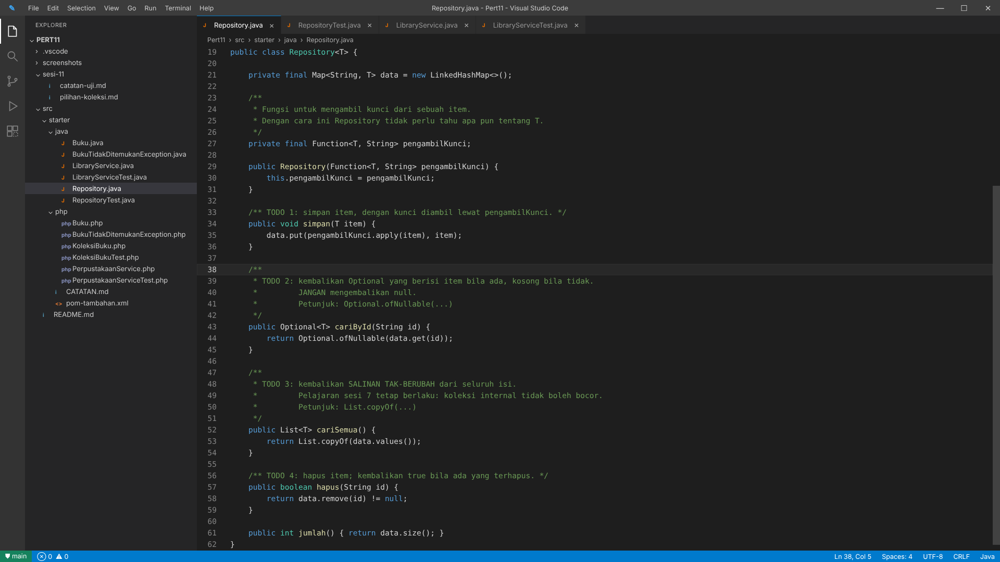
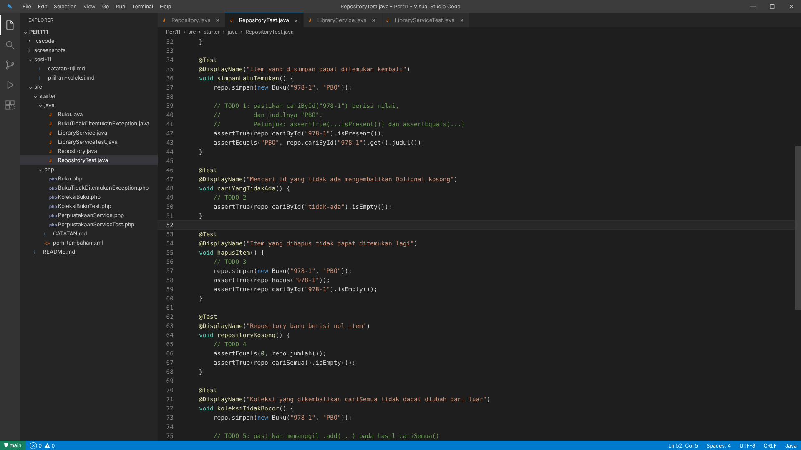
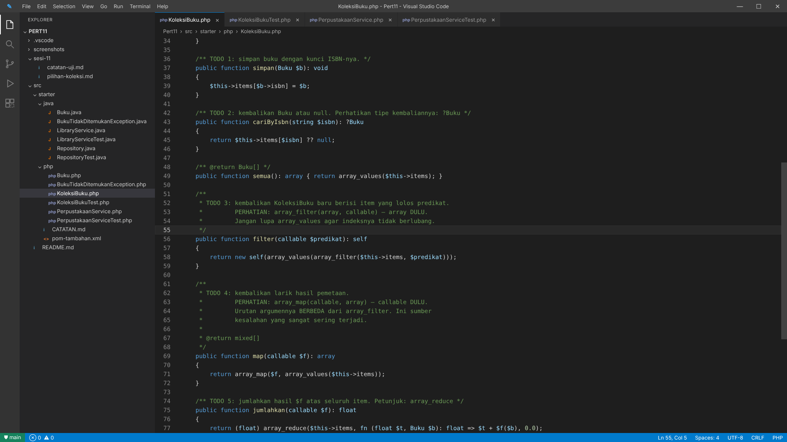
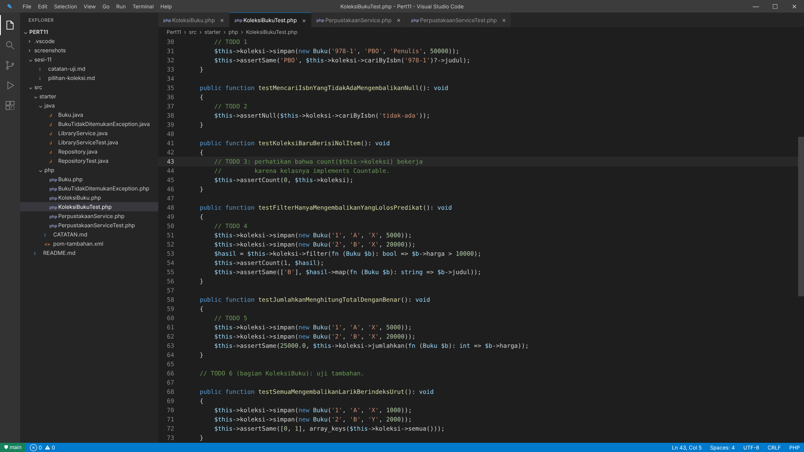

# PRAKTIKUM PERTEMUAN 11
## Collections, Generics, dan Unit Test Pertama

**Nama:** Muzaki Arifin  
**NPM:** 4525210051  
**Kelas:** PBO A 2026/2027  
**Dosen Pengampu:** Adi Wahyu Pribadi, S.Si., M.Kom

---

## 1. Deskripsi Praktikum

Praktikum pertemuan 11 membahas penggunaan Collections, Generics, dan Unit Testing pada bahasa pemrograman Java dan PHP.

Tujuan praktikum ini adalah memahami penggunaan struktur data, membuat kelas generik, mengelola data menggunakan operasi fungsional, serta melakukan pengujian program menggunakan JUnit 5 dan PHPUnit.

## 2. Tujuan Praktikum

1. Memahami penggunaan Collections Framework.
2. Menerapkan konsep Generics pada Java.
3. Menggunakan Optional untuk menghindari pengembalian nilai null.
4. Memahami operasi filter, map, dan grouping.
5. Membuat unit test menggunakan JUnit 5.
6. Membuat unit test menggunakan PHPUnit.

## 3. Materi Praktikum

### A. Java

Beberapa materi yang dipelajari:
- Repository Generic `<T>`.
- Collections menggunakan Map dan List.
- Optional untuk pencarian data.
- Penghapusan data berdasarkan ID.
- Unit Testing menggunakan JUnit 5.
- Pengujian menggunakan assertEquals, assertTrue, dan assertThrows.

### B. PHP

Materi yang dipelajari:
- Typed Collection.
- Nullable Type `?Buku`.
- Array Filter dan Array Map.
- Array Reduce.
- Grouping Data.
- Unit Testing menggunakan PHPUnit.

## 4. Struktur Folder

```text
Pert11/
│
├── .vscode/
├── lib/
├── screenshots/
│   ├── 01-repository-java.png
│   ├── 02-repositorytest-java.png
│   ├── 03-koleksibuku-php.png
│   └── 04-koleksibukutest-php.png
│
├── src/
│   ├── Modul-Praktikum-11.docx
│   ├── PPT-Praktikum-11.pptx
│   └── starter/
│       ├── java/
│       ├── php/
│       └── pom-tambahan.xml
│
└── README.md
```

## 5. Penjelasan Program

**Java**

Program Repository digunakan untuk menyimpan, mencari, menampilkan, dan menghapus data buku menggunakan konsep Generics.

Program juga menggunakan Optional agar pencarian data lebih aman dan tidak mengembalikan null secara langsung.

**PHP**

Program KoleksiBuku digunakan untuk mengelola kumpulan data buku menggunakan typed collection.

Beberapa operasi yang digunakan adalah:
- `simpan()` untuk menyimpan buku.
- `cariByIsbn()` untuk mencari buku berdasarkan ISBN.
- `filter()` untuk menyaring data.
- `map()` untuk mengubah data.
- `jumlahkan()` untuk menghitung nilai.
- `kelompokkan()` untuk mengelompokkan buku berdasarkan penulis.

## 6. Dokumentasi Praktikum

Berikut dokumentasi kode program yang dikerjakan:

**Repository.java**



**RepositoryTest.java**



**KoleksiBuku.php**



**KoleksiBukuTest.php**



## 7. Kesimpulan

Melalui praktikum pertemuan 11, saya mempelajari penggunaan Collections dan Generics untuk mengelola data secara lebih terstruktur. Selain itu, saya memahami penggunaan Optional pada Java dan Nullable Type pada PHP untuk menangani pencarian data.

Saya juga mempelajari pentingnya Unit Testing menggunakan JUnit 5 dan PHPUnit untuk memastikan fungsi program berjalan sesuai dengan yang diharapkan.

---
