# Praktikum 12 — Refactoring dengan SOLID dan Repository Pattern

**Nama:** Muzaki Arifin  
**NPM:** 4525210051  
**Kelas:** PBO A 2025/2026  
**Dosen Pengampu:** Adi Wahyu Pribadi, S.Si., M.Kom

Praktikum ini merefaktor Sistem Perpustakaan dari sesi 10–11 agar patuh pada prinsip SOLID. Penyimpanan data dipisahkan dari aturan bisnis dengan *Repository pattern* (`BookRepository` dan `InMemoryBookRepository`), aturan denda dipisahkan dengan *Strategy pattern* (`AturanDenda` beserta `AturanDendaFactory`), dan seluruh dependensi disuntikkan lewat constructor secara manual (*manual dependency injection*). Hasilnya dibuktikan lewat unit test, termasuk satu uji dengan repository palsu yang selalu melempar exception. Implementasi tersedia dalam Java dan PHP.

## Java

### BookRepository.java

#### Sebelum

#### Sesudah

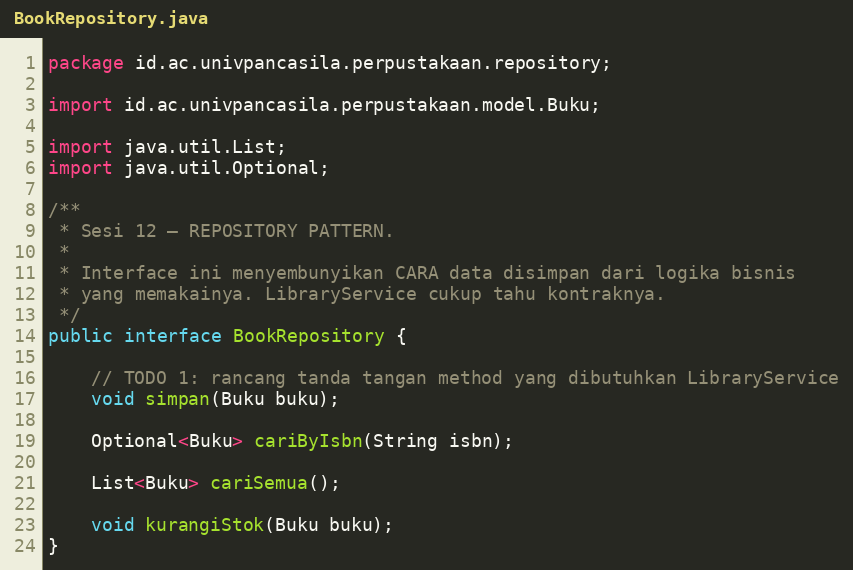

Versi sebelum hanya kerangka dengan komentar TODO. Setelah dikerjakan, interface ini menjadi kontrak penyimpanan yang dibutuhkan `LibraryService`: `simpan(Buku)`, `cariByIsbn(String)` yang mengembalikan `Optional<Buku>` agar kasus "tidak ditemukan" eksplisit, `cariSemua()`, dan `kurangiStok(Buku)`. `LibraryService` cukup mengenal kontrak ini tanpa tahu data disimpan di memori atau basis data.

### InMemoryBookRepository.java

#### Sebelum

#### Sesudah

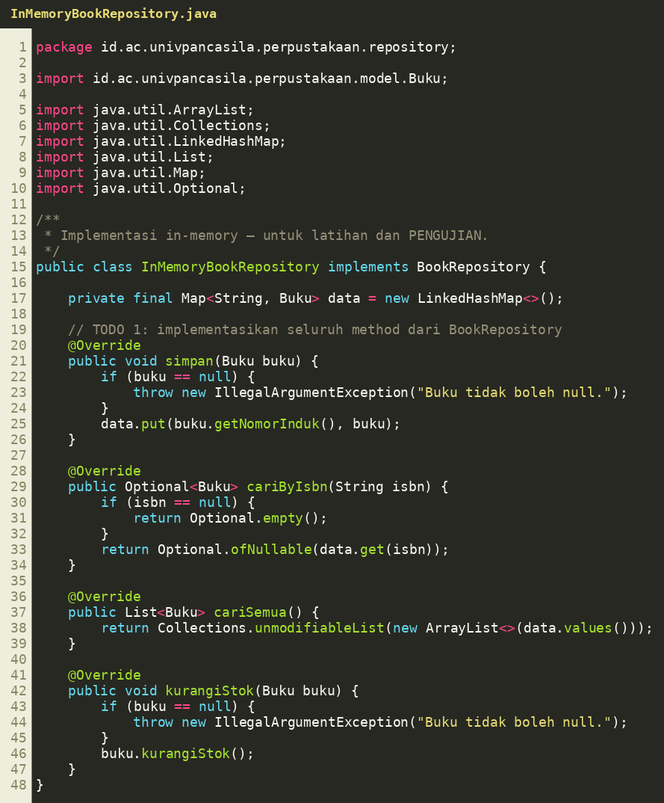

Implementasi disimpan di `LinkedHashMap` dengan kunci nomor induk buku sehingga pencarian berdasarkan ISBN cepat dan urutan simpan terjaga. `simpan` dan `kurangiStok` menolak `null` dengan `IllegalArgumentException`, `cariByIsbn` mengembalikan `Optional.empty()` untuk ISBN `null` atau yang tidak ada, dan `cariSemua` mengembalikan salinan tak-berubah (`Collections.unmodifiableList`) agar koleksi internal tidak bocor.

### AturanDenda.java, Denda*.java, dan AturanDendaFactory.java

#### Sebelum

#### Sesudah

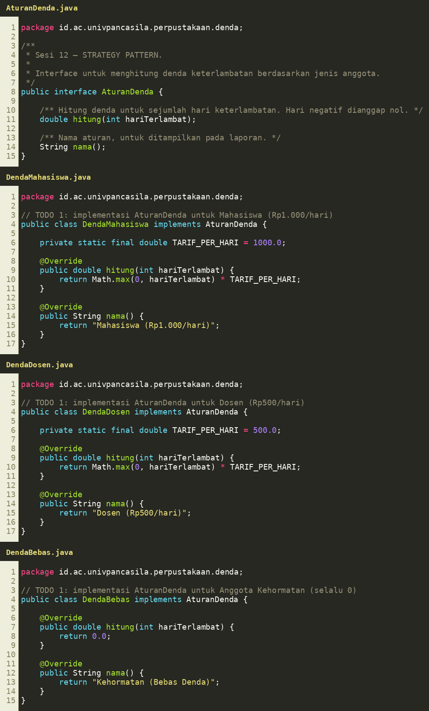

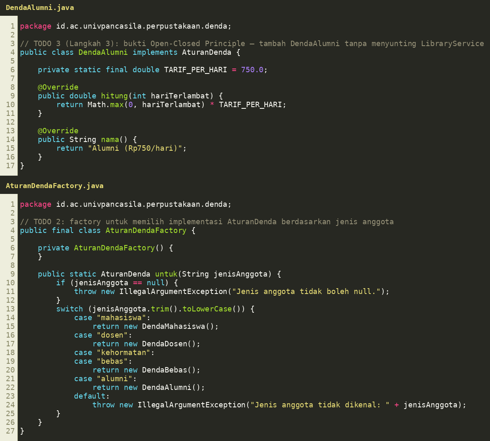

Interface `AturanDenda` (Strategy) punya dua method: `hitung(int hariTerlambat)` dan `nama()`. Implementasinya adalah `DendaMahasiswa` (Rp1.000/hari), `DendaDosen` (Rp500/hari), `DendaBebas` (selalu 0, untuk anggota kehormatan), dan `DendaAlumni` (Rp750/hari) sebagai bukti Open-Closed. Hari terlambat negatif diperlakukan sebagai nol lewat `Math.max(0, ...)`. `AturanDendaFactory.untuk(jenisAnggota)` memilih implementasi berdasarkan jenis anggota (tanpa membedakan huruf besar/kecil), dan melempar `IllegalArgumentException` bila jenisnya `null` atau tidak dikenal.

### LibraryService.java

#### Sebelum

#### Sesudah

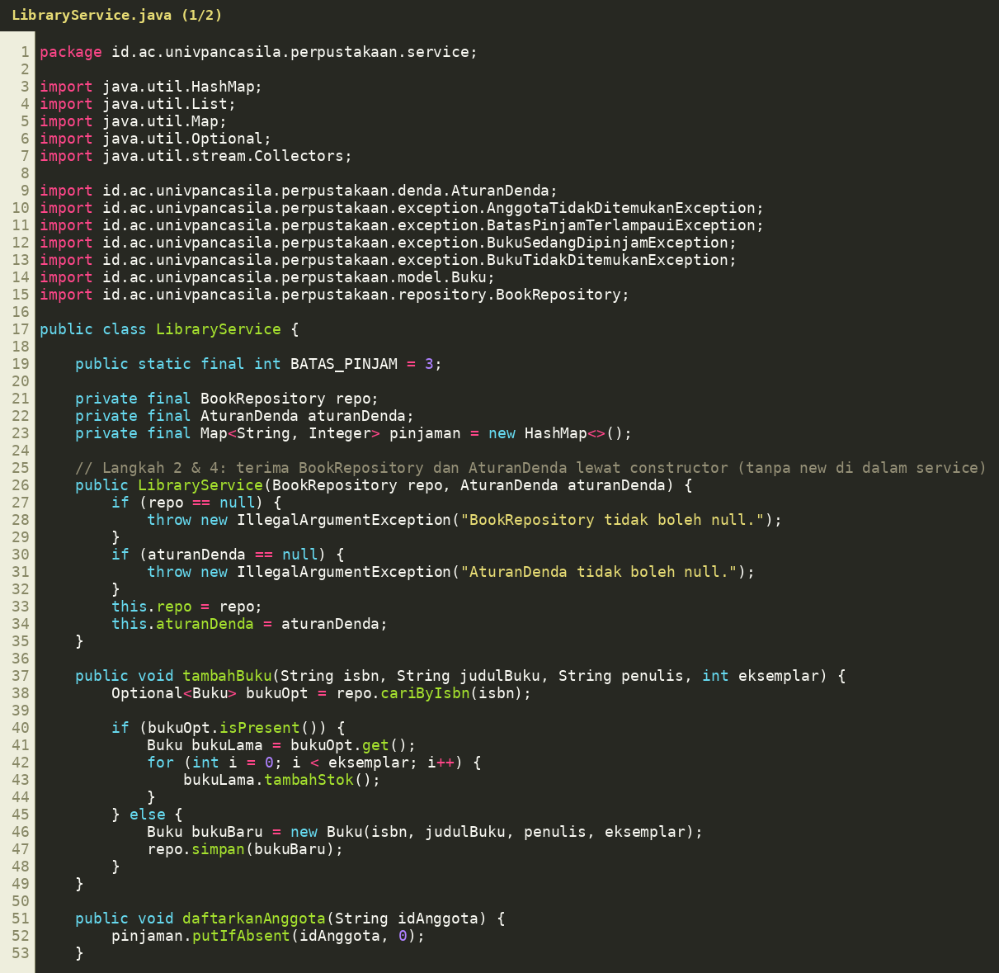

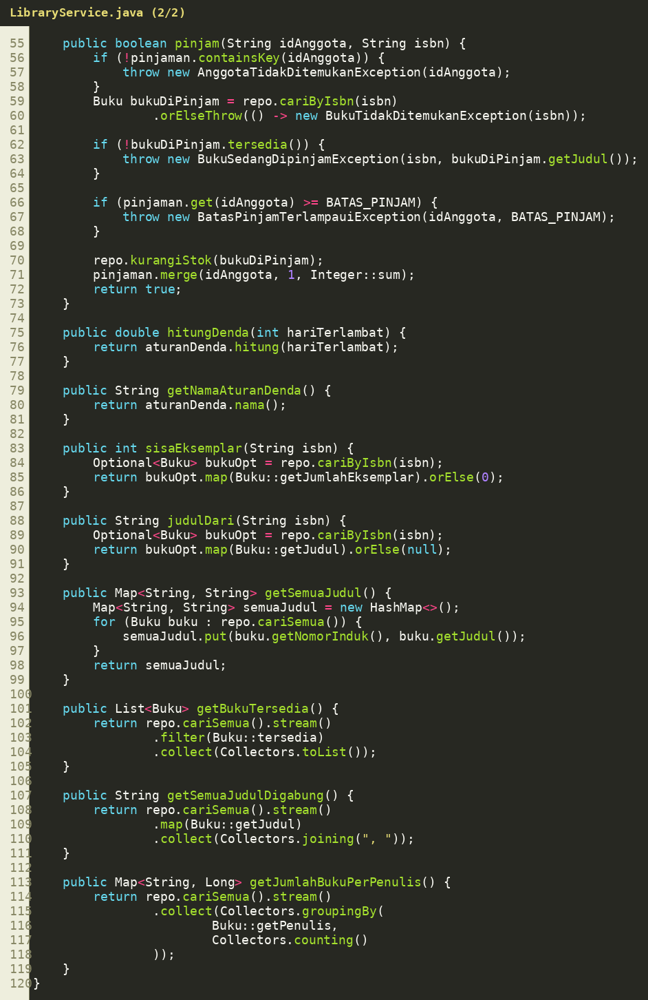

Sebelumnya `LibraryService` membuat sendiri penyimpanannya dengan `new Repository<>(Buku::getNomorInduk)`. Sekarang constructor-nya menerima `BookRepository` dan `AturanDenda` (keduanya ditolak bila `null`), sehingga tidak ada lagi `new` untuk urusan penyimpanan di dalam kelas ini. Method `pinjam` memakai guard clause berurutan: anggota tidak terdaftar, buku tidak ditemukan, buku sedang dipinjam, lalu batas pinjam (`BATAS_PINJAM = 3`), masing-masing dengan exception khusus. Penghitungan denda didelegasikan ke `aturanDenda.hitung(...)`.

### Main.java

#### Sebelum

#### Sesudah

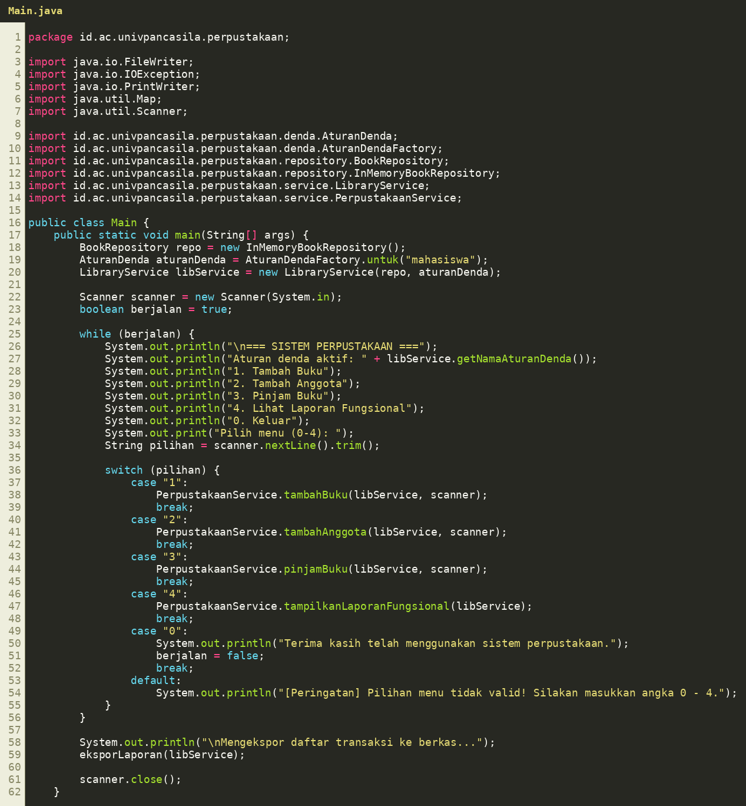

`Main` menjadi satu-satunya tempat kelas konkret disebut: membuat `InMemoryBookRepository`, memilih aturan lewat `AturanDendaFactory.untuk("mahasiswa")`, lalu menyuntikkan keduanya ke `new LibraryService(repo, aturanDenda)`. Menu konsol dan ekspor `laporan_buku.txt` tetap seperti sebelumnya.

### LibraryServiceTest.java

#### Sebelum

#### Sesudah

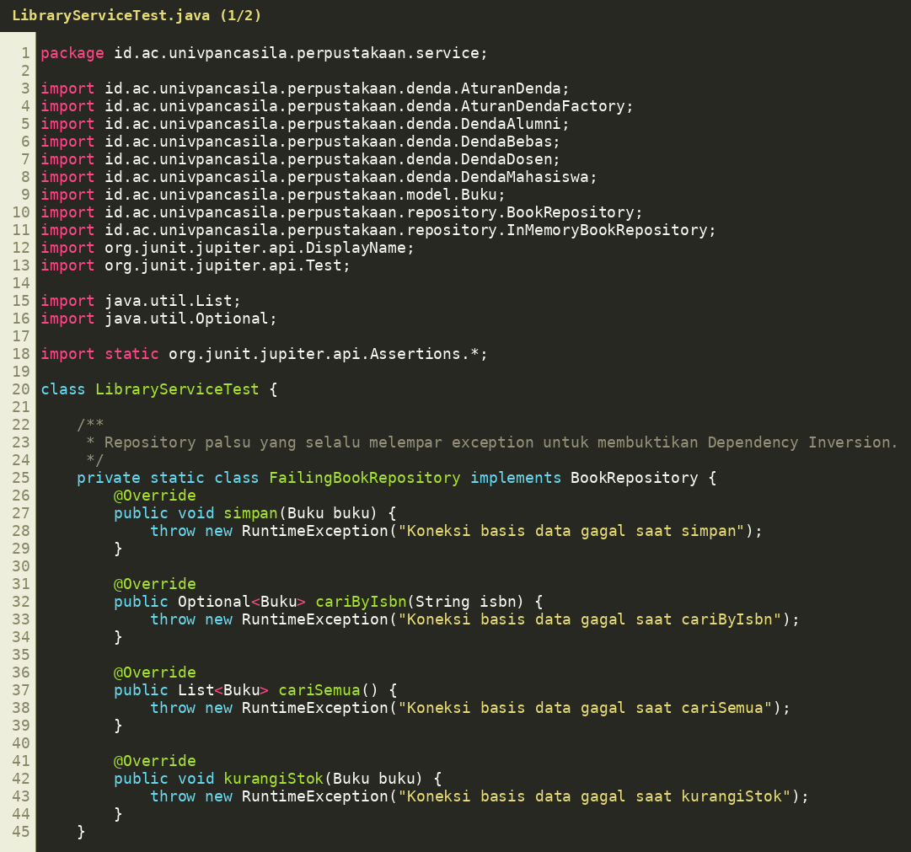

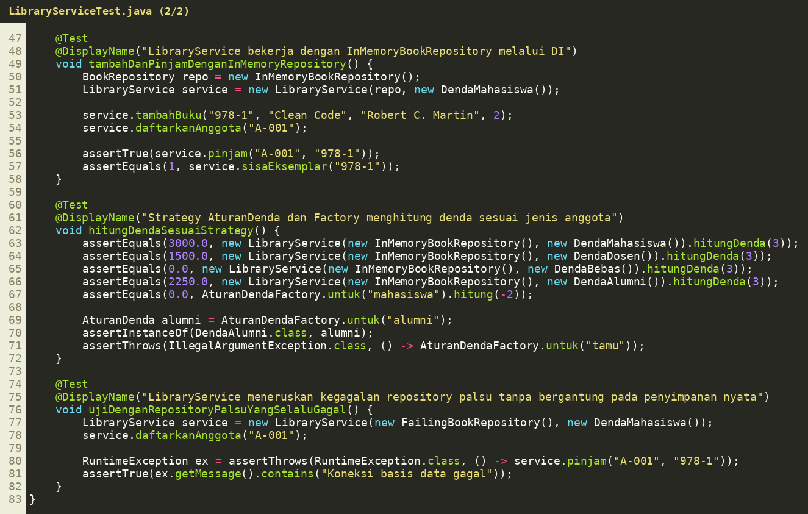

Ada tiga uji. Pertama, `LibraryService` bekerja dengan `InMemoryBookRepository` lewat DI: tambah buku, daftar anggota, pinjam, lalu sisa eksemplar berkurang dari 2 menjadi 1. Kedua, Strategy dan Factory menghitung denda 3 hari sesuai jenis anggota (Rp3.000 mahasiswa, Rp1.500 dosen, Rp0 kehormatan, Rp2.250 alumni), hari negatif menghasilkan 0, dan jenis tidak dikenal ditolak. Ketiga, `FailingBookRepository` yang selalu melempar `RuntimeException` dipakai untuk membuktikan bahwa `LibraryService` dapat diuji terpisah dari penyimpanan sesungguhnya, sesuatu yang tidak mungkin ditulis sebelum refactoring karena repository dulu dibuat di dalam service.

## PHP

### BookRepository.php

#### Sebelum

#### Sesudah

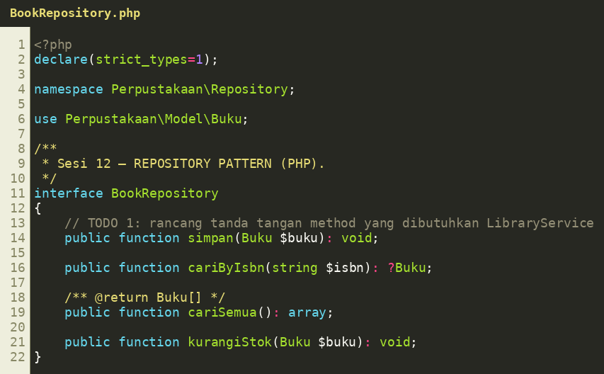

Padanan PHP dari kontrak penyimpanan: `simpan(Buku): void`, `cariByIsbn(string): ?Buku` (tipe nullable menggantikan `Optional`), `cariSemua(): array`, dan `kurangiStok(Buku): void`, dengan `declare(strict_types=1)`.

### InMemoryBookRepository.php

#### Sebelum

#### Sesudah

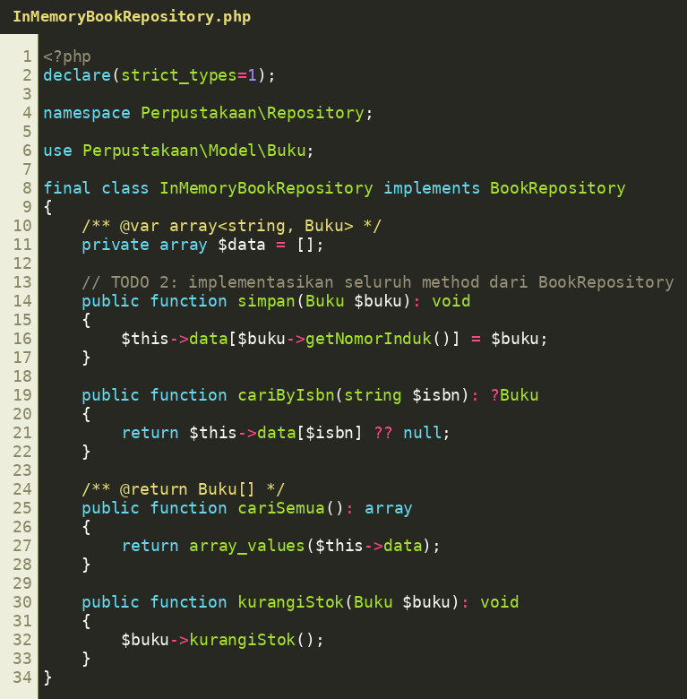

Kelas `final` ini menyimpan buku di array asosiatif berkunci nomor induk. `cariByIsbn` memakai operator `?? null`, sedangkan `cariSemua` mengembalikan `array_values(...)` sehingga indeks rapi dan array internal tidak dibagikan.

### AturanDenda.php, Denda*.php, dan AturanDendaFactory.php

#### Sebelum

#### Sesudah

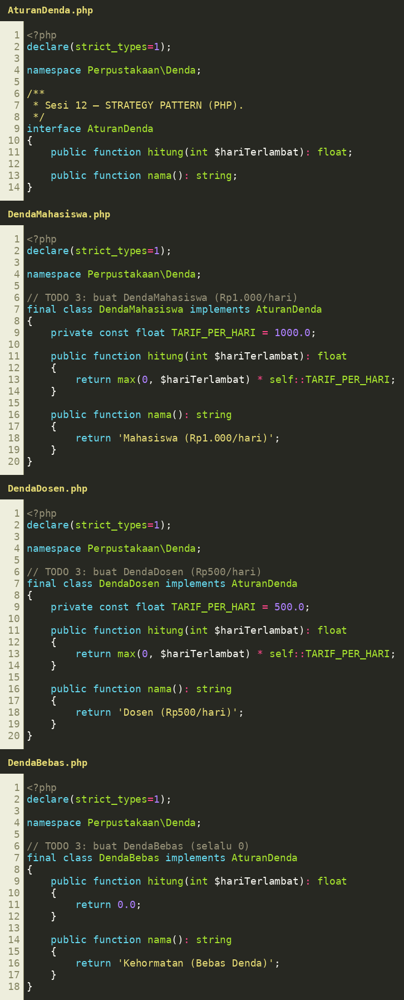

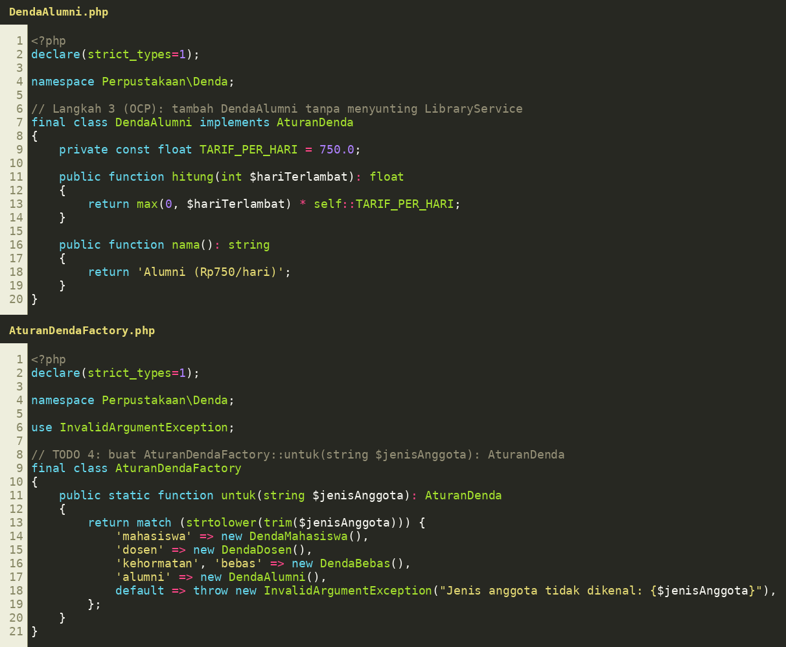

Struktur dan tarifnya sama dengan versi Java: `DendaMahasiswa`, `DendaDosen`, `DendaBebas`, dan `DendaAlumni`, semuanya `final` dan mengimplementasikan interface `AturanDenda`. `AturanDendaFactory::untuk()` memakai ekspresi `match` dengan `strtolower(trim(...))` dan melempar `InvalidArgumentException` untuk jenis yang tidak dikenal.

### LibraryService.php

#### Sebelum

#### Sesudah

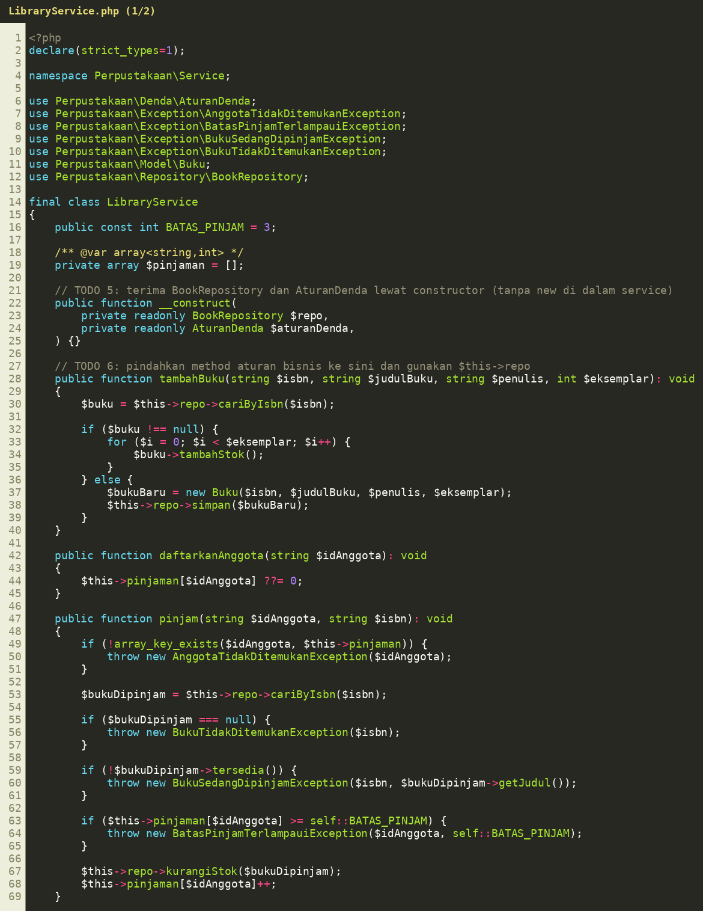

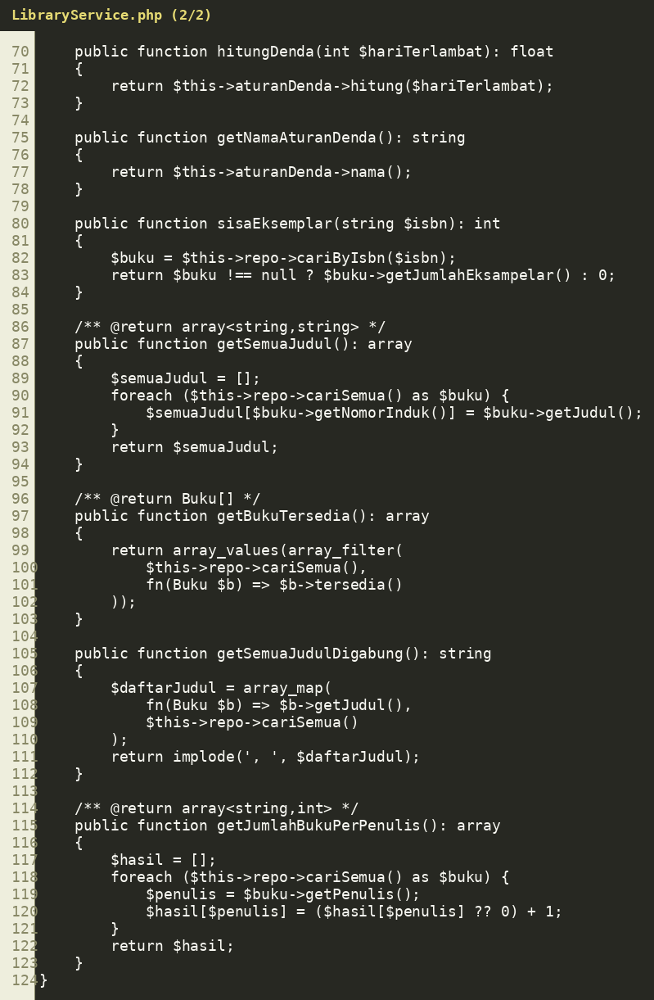

Sebelumnya `LibraryService` membuat `new KoleksiBuku()` sendiri. Sekarang `BookRepository` dan `AturanDenda` diterima lewat *constructor promotion* dengan properti `private readonly`. Method `pinjam` memakai guard clause dan melempar exception khusus untuk anggota tidak terdaftar, buku tidak ditemukan, buku sedang dipinjam, dan batas pinjam tercapai.

### main.php

#### Sebelum

#### Sesudah

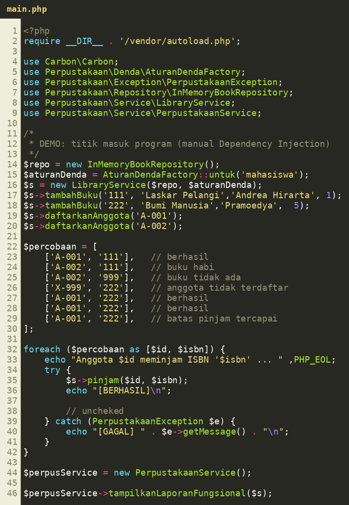

`main.php` merakit objek di satu tempat: `new InMemoryBookRepository()`, `AturanDendaFactory::untuk('mahasiswa')`, lalu `new LibraryService($repo, $aturanDenda)`. Tujuh skenario peminjaman dijalankan dan tiap kegagalan ditangkap lewat `PerpustakaanException`.

### LibraryServiceTest.php

#### Sebelum

#### Sesudah

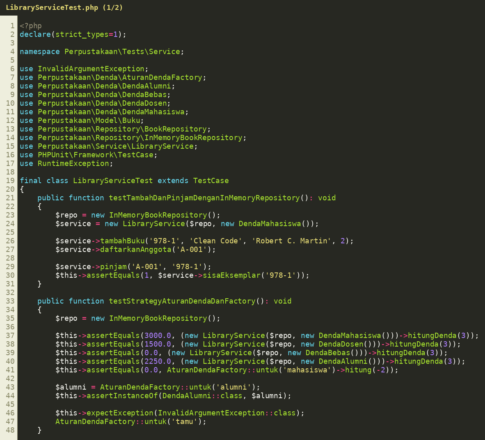

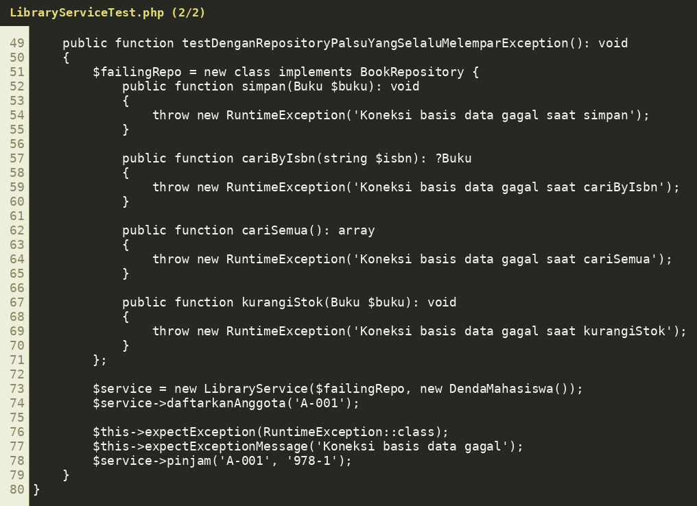

Tiga uji yang sama dengan Java: DI dengan `InMemoryBookRepository`, Strategy dan Factory (Rp3.000, Rp1.500, Rp0, Rp2.250 untuk 3 hari), serta repository palsu berupa kelas anonim yang mengimplementasikan `BookRepository` dan selalu melempar `RuntimeException`.

## REFACTORING.md

Dokumen [REFACTORING.md](src/starter/REFACTORING.md) berisi lima bagian yang diminta modul.

**Bagian 1, tiga temuan pelanggaran SOLID.**

| Prinsip | Letak | Ringkasan |
|---|---|---|
| DIP | `LibraryService` sebelum refactoring (Java baris 20–21, PHP baris 19–22) | Membuat penyimpanan konkret sendiri sehingga tidak bisa diganti atau diuji dengan repository tiruan. |
| OCP | `LibraryService` sebelum memakai `AturanDenda` | Aturan denda per jenis anggota berupa rantai `if/else` yang harus disunting tiap ada jenis baru. |
| SRP | `PerpustakaanService` dan `LibraryService` | Satu kelas mengurus penyimpanan sekaligus aturan bisnis, dan satu lagi mengurus input sekaligus format output. |

**Bagian 2, bukti Open-Closed.** Menambah aturan denda alumni hanya menambah satu berkas baru (`DendaAlumni`) dan satu cabang `case "alumni"` di factory. `LibraryService` tidak disunting sama sekali.

**Bagian 3, bukti Dependency Inversion.** Bila penyimpanan diganti dari memori ke basis data, cukup satu berkas baru (`DatabaseBookRepository`) dan satu baris perakitan di `Main` / `main.php`. `LibraryService` tidak berubah.

**Bagian 4, yang sengaja tidak diberi pattern.** Pembuatan objek `Buku` di `LibraryService.tambahBuku(...)` sengaja tidak memakai Factory atau Builder. Constructor `Buku(isbn, judul, penulis, eksemplar)` hanya punya empat parameter yang jelas dan tidak ada varian subkelas, sehingga Factory hanya menambah lapisan tanpa manfaat nyata.

## Hasil keseluruhan

### Java — sebelum

### Java — setelah

### PHP — sebelum

### PHP — setelah

Hasil `mvn test` pada Java: `RepositoryTest` menjalankan 9 uji dan `LibraryServiceTest` 3 uji, total 12 uji dengan 0 gagal dan 0 error. Pada PHP terdapat 13 uji PHPUnit (10 di `KoleksiBukuTest` dan 3 di `LibraryServiceTest`) yang dijalankan dengan `./vendor/bin/phpunit tests`.

## Berkas praktikum

- [Sumber Java](src/starter/java/src/)
- [Sumber PHP](src/starter/php/)
- [REFACTORING.md](src/starter/REFACTORING.md)

### Kesimpulan

Repository pattern memisahkan cara penyimpanan dari aturan bisnis, Strategy membuat jenis aturan denda baru cukup berupa kelas baru, dan constructor injection memusatkan perakitan objek di titik masuk program. Dengan begitu `LibraryService` dapat diuji memakai repository palsu tanpa penyimpanan sesungguhnya, dan pilihan untuk tidak memberi pattern pada pembuatan `Buku` menunjukkan bahwa pattern dipakai hanya bila ada kebutuhan nyata.
